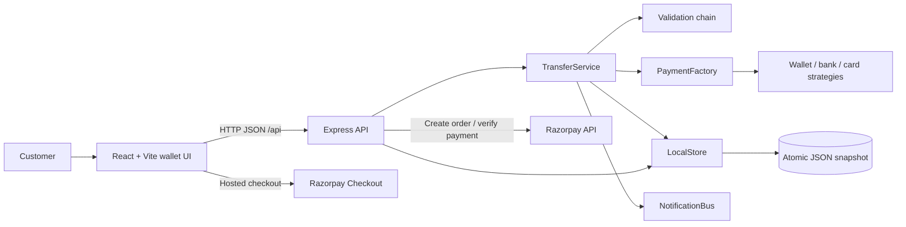
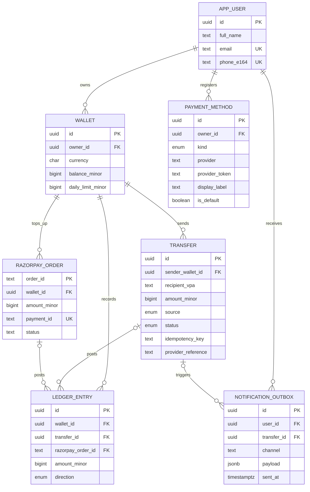
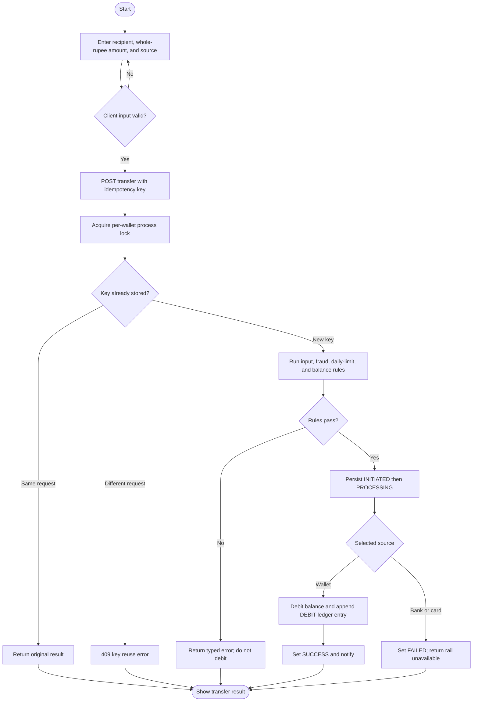

# Veyra — Mini UPI Wallet

Veyra is a classroom system-design project: a responsive wallet dashboard backed by a TypeScript/Express API. It demonstrates wallet-funded transfers, retry-safe idempotency, per-wallet concurrency control, an append-only ledger, and Razorpay test-mode top-ups.

> **Demo scope:** Veyra does not authenticate users or transfer real UPI funds. All API requests act on one local demo wallet. Razorpay checkout is optional and must use test credentials. Bank/card payout rails and a refund workflow are not implemented.

## Contents

- [What the app does](#what-the-app-does)
- [Architecture](#architecture)
- [Requirements](#requirements)
- [Run locally](#run-locally)
- [Configuration](#configuration)
- [API reference](#api-reference)
- [Data model](#data-model)
- [UML class diagram](#uml-class-diagram)
- [Transfer sequence](#transfer-sequence)
- [Top-up sequence](#top-up-sequence)
- [Transfer activity](#transfer-activity)
- [Patterns and SOLID](#patterns-and-solid)
- [Validation and failure behavior](#validation-and-failure-behavior)
- [Project layout](#project-layout)
- [Known limitations and production work](#known-limitations-and-production-work)
- [Detailed design documents](#detailed-design-documents)

## What the app does

The web app provides:

- Wallet balance overview, visibility toggle, daily send-limit progress, and recent activity.
- Send flow for a UPI-style recipient identifier with a note and a wallet funding source.
- Searchable and filterable activity, transfer detail view, and CSV statement download.
- People shortcuts, a wallet ledger view, and responsive navigation.
- Razorpay Checkout wallet top-up when server-side test credentials are configured.

The API provides:

- Wallet-funded transfer validation, idempotent retries, and per-wallet request serialization.
- Persistent local demo state for wallet balance, transfers, idempotency keys, top-up orders, and ledger entries.
- Server-side Razorpay order creation, signature and captured-payment verification, and one-time wallet credit.
- Typed JSON errors and a health endpoint.

Dashboard chart totals and the initial activity rows are illustrative sample data. The wallet balance and new transfers come from the API. Bank and card entries are display-only examples; choosing those payout sources returns an explicit unavailable-rail error.

## Architecture



The browser never receives the Razorpay secret. It receives only the public key ID and the server-created order. The server checks the returned signature and fetches the payment to verify its captured status, order, currency, and amount before crediting the wallet.

## Requirements

| Type | Requirement |
|---|---|
| Functional | Read the wallet balance, daily limit, transfer history, and ledger. |
| Functional | Send a wallet-funded transfer after validating recipient, amount, fraud rule, daily limit, and available balance. |
| Functional | Treat a repeated idempotency key with the same request as the original transfer; reject a key reused with different details. |
| Functional | Serialize wallet mutations so concurrent sends cannot spend the same balance twice within the single API process. |
| Functional | Append debit/credit ledger records and persist demo state across API restarts. |
| Functional | Create Razorpay test orders and credit a top-up once, only after server-side verification. |
| Non-functional | Represent money as integer paise in storage and use whole-rupee amounts in the current send form. |
| Non-functional | Return structured errors, keep provider secrets server-side, and support responsive keyboard-accessible UI. |
| Out of scope | User authentication, multi-user isolation, real UPI/IMPS/NEFT payouts, bank/card linking, production-grade database transactions, and automated refunds. |

## Run locally

### Prerequisites

- Node.js 22 or later
- npm
- Optional: a Razorpay account with **test-mode** API keys for checkout top-ups

### Install

From the repository root:

```sh
npm install
```

### Configure the API

Copy the example file:

```sh
cp server/.env.example server/.env
```

The API can run without Razorpay keys; wallet transfers still work. Top-ups return `RAZORPAY_NOT_CONFIGURED` until test keys are set in `server/.env`:

```dotenv
PORT=4000
WEB_ORIGIN=http://localhost:5174
RAZORPAY_KEY_ID=rzp_test_your_key_id
RAZORPAY_KEY_SECRET=your_test_key_secret
```

Never commit `server/.env` or use live Razorpay credentials with this demo. The file is ignored by Git.

### Start both services

Open two terminals in the repository root.

Terminal 1 — API:

```sh
npm run dev:server
```

Terminal 2 — web app:

```sh
npm run dev
```

Open **http://localhost:5174**. The Vite server proxies `/api` requests to the API at port `4000`. Port `5174` is fixed with `strictPort`; if it is occupied, stop the process using it before starting Veyra.

### Try the main flows

1. Open the overview and confirm the API status reads **Connected to demo API**.
2. Choose **Send money**, enter a recipient such as `mira@okaxis`, and send a whole-rupee amount within the available balance. The transfer appears in activity and the wallet ledger.
3. Open **Activity** to search/filter transfers, then select a row to inspect its details. Use **Statements** in the sidebar to download a CSV.
4. Choose **Add money** to start Razorpay Checkout. This requires valid Razorpay test keys and a successful test payment; without keys, the API reports that checkout is not configured.

The first run seeds a local wallet balance of ₹48,290.50. Subsequent runs reuse the saved wallet data. To reset the local demo, stop the API and remove the ignored state file, then restart the API:

```sh
rm server/data/state.json
```

Check API availability:

```sh
curl http://localhost:4000/api/health
```

Expected response:

```json
{"status":"ok","service":"veyra-api"}
```

### Build

```sh
npm run build
```

This runs the web TypeScript/Vite production build and the server TypeScript check.

## Configuration

| Variable | Default | Purpose |
|---|---|---|
| `PORT` | `4000` | Express API listen port. |
| `WEB_ORIGIN` | `http://localhost:5174` | Allowed browser origin for CORS. |
| `RAZORPAY_KEY_ID` | unset | Razorpay test public key ID. |
| `RAZORPAY_KEY_SECRET` | unset | Razorpay test secret; server only. |
| `VEYRA_STATE_FILE` | `server/data/state.json` | Optional path for the local JSON snapshot. |

## API reference

All routes are prefixed with `/api`. JSON errors use `{ "error": { "code": "...", "message": "..." } }`.

| Method and path | Request | Success response / behavior |
|---|---|---|
| `GET /api/health` | — | `{ status, service }` health response. |
| `GET /api/wallet` | — | `{ walletId, currency, balanceMinor, dailySpentMinor, dailyLimitMinor }`; amounts are paise. |
| `GET /api/transfers` | — | Transfer records with ID, recipient, amount in rupees, note, source, status, timestamp, and idempotency key. |
| `GET /api/ledger` | — | Ledger entries with wallet/reference IDs, amount in paise, direction, and timestamp. |
| `POST /api/transfers` | `Idempotency-Key` header and `{ recipient, amount, note?, paymentMethod }` | `{ transferId, status, amount }`; `amount` is rupees. Current UI caps sends at ₹25,000; the domain accepts up to ₹1,00,000. |
| `POST /api/razorpay/orders` | `{ amount }` in whole rupees | `201` with `{ orderId, amount, currency, keyId }`; provider amount is paise. Amount range: ₹100–₹1,00,000. |
| `POST /api/razorpay/verify` | `{ orderId, paymentId, signature }` from Checkout | `{ verified, balanceMinor, paymentId }` after server verification and one-time credit. |

Example wallet-funded transfer:

```sh
curl -X POST http://localhost:4000/api/transfers \
  -H 'Content-Type: application/json' \
  -H 'Idempotency-Key: demo-send-001' \
  -d '{"recipient":"mira@okaxis","amount":250,"note":"Lunch","paymentMethod":"Veyra balance"}'
```

Use the same `Idempotency-Key` and the same body to safely retry an uncertain request. A changed request with the same key returns `409 IDEMPOTENCY_KEY_REUSED`.

## Data model

The running demo stores a process-local model in `LocalStore`, then writes atomic JSON snapshots to disk. Amounts are persisted as paise. A production-oriented PostgreSQL mapping is provided in [`docs/schema.sql`](docs/schema.sql); it is a design artifact and is not connected to the running app.



The database design enforces unique `(sender_wallet_id, idempotency_key)` and ledger reference constraints. In production, wallet mutation, transfer state, and ledger insertion must share one database transaction.

## UML class diagram

This diagram describes the classes and data types currently implemented in `server/src/domain.ts` and assembled by `server/src/container.ts`. User, wallet, and payment-method tables in the ER diagram are future relational persistence concepts; they are not separate runtime classes in this demo.

```mermaid
classDiagram
  class Request {
    +senderId: string
    +recipient: string
    +amount: number
    +note?: string
    +source: Source
    +transferId?: string
  }
  class Transfer {
    +id: string
    +key: string
    +requestHash: string
    +status: Status
    +createdAt: Date
  }
  class Entry {
    +id: string
    +walletId: string
    +referenceId: string
    +amountMinor: number
    +direction: Direction
    +createdAt: Date
  }
  class Source {
    <<type>>
    WALLET
    BANK
    CARD
  }
  class Status {
    <<type>>
    INITIATED
    PROCESSING
    SUCCESS
    FAILED
    REFUNDED
  }
  class Direction {
    <<type>>
    DEBIT
    CREDIT
  }
  class TransferService {
    -store: LocalStore
    -factory: PaymentFactory
    -notifier: Notifier
    -rules: TransferRule
    +constructor(store: LocalStore, factory: PaymentFactory, notifier: Notifier)
    +send(request: Request, key: string) Promise~Transfer~
    -complete(request: Request, transfer: Transfer) Promise~Transfer~
  }
  class TransferRule {
    <<interface>>
    +check(request: Request) Promise~void~
    +next(rule: TransferRule) TransferRule
  }
  class Rule {
    <<abstract>>
    -following: TransferRule
    +check(request: Request) Promise~void~
    #validate(request: Request) Promise~void~
    +next(rule: TransferRule) TransferRule
  }
  class InputRule {
    #validate(request: Request) Promise~void~
  }
  class FraudRule {
    #validate(request: Request) Promise~void~
  }
  class DailyLimitRule {
    -total: Function
    +constructor(total: Function)
    #validate(request: Request) Promise~void~
  }
  class BalanceRule {
    -store: LocalStore
    +constructor(store: LocalStore)
    #validate(request: Request) Promise~void~
  }
  class PaymentStrategy {
    <<interface>>
    +source: Source
    +authorize(request: Request) Promise~void~
  }
  class WalletPayment {
    -store: LocalStore
    +constructor(store: LocalStore)
    +authorize(request: Request) Promise~void~
  }
  class ExternalPayment {
    +source: Source
    +constructor(source: Source)
    +authorize(request: Request) Promise~void~
  }
  class PaymentFactory {
    -strategies: PaymentStrategy[]
    +constructor(strategies: PaymentStrategy[])
    +for(source: Source) PaymentStrategy
  }
  class Notifier {
    <<interface>>
    +notify(user: string, message: string) Promise~void~
  }
  class NotificationBus {
    -observers: Notifier[]
    +constructor(observers: Notifier[])
    +attach(observer: Notifier) void
    +notify(user: string, message: string) Promise~void~
  }
  class ConsoleNotifier {
    +notify(user: string, message: string) Promise~void~
  }
  class LoggingDecorator {
    -wrapped: PaymentStrategy
    +source: Source
    +constructor(wrapped: PaymentStrategy)
    +authorize(request: Request) Promise~void~
  }
  class LocalStore {
    +constructor()
    +entries: readonly Entry[]
    +transfers: Map
    +balances: Map
    +topups: Map
    -ledger: Entry[]
    -idempotency: Map
    -locks: Map
    -file: string
    +lock(id: string, operation) Promise~T~
    +balance(id: string) Promise~number~
    +find(key: string) Promise~Transfer~
    +save(transfer: Transfer) Promise~void~
    +updateStatus(id: string, next: Status) Promise~void~
    +hasLedgerEntry(referenceId, direction) boolean
    +recordDebit(walletId, amountMinor, transferId) Promise~void~
    +append(entry: Entry) Promise~void~
    +daily(userId: string) Promise~number~
    +register(orderId, amount) Promise~void~
    +settle(orderId, paymentId) Promise~object~
    -load() void
    -persist() void
  }
  class State {
    -transitions: Record~Status, Status[]~
    +move(current: Status, next: Status) Status
  }
  class DomainError {
    +code: string
    +httpStatus: number
    +constructor(code: string, message: string, httpStatus?: number)
  }
  class RazorpayOrderBuilder {
    -data: object
    +amount(value: number) RazorpayOrderBuilder
    +receipt(value: string) RazorpayOrderBuilder
    +wallet(value: string) RazorpayOrderBuilder
    +build() object
  }

  TransferRule <|.. Rule
  Rule <|-- InputRule
  Rule <|-- FraudRule
  Rule <|-- DailyLimitRule
  Rule <|-- BalanceRule
  PaymentStrategy <|.. WalletPayment
  PaymentStrategy <|.. ExternalPayment
  PaymentStrategy <|.. LoggingDecorator
  Notifier <|.. NotificationBus
  Notifier <|.. ConsoleNotifier
  Rule "1" --> "0..1" TransferRule : next rule
  LoggingDecorator "1" o--> "1" PaymentStrategy : wraps
  NotificationBus "1" o--> "0..*" Notifier : observers
  PaymentFactory "1" o--> "0..*" PaymentStrategy : selects
  TransferService "1" --> "1" LocalStore : uses
  TransferService "1" --> "1" PaymentFactory : selects strategy
  TransferService "1" --> "1" TransferRule : chain head
  TransferService "1" --> "1" Notifier : publishes result
  TransferService ..> State : transitions
  LocalStore ..> State : validates transitions
  LocalStore "1" o-- "0..*" Transfer : stores
  LocalStore "1" *-- "0..*" Entry : ledger records
  Transfer --> Source
  Transfer --> Status
  Entry --> Direction
  Request --> Source
  DomainError --|> Error
```



`Source`, `Status`, and `Direction` are TypeScript string-union types rather than runtime enum classes. `Transfer` is a TypeScript intersection of `Request` and its persisted fields.

`TransferService` currently depends directly on `LocalStore`, the single-process demo repository. The production database adapter and repository interface are extension points, not implemented classes.

## Transfer sequence

```mermaid
sequenceDiagram
  actor Customer
  participant UI as React wallet UI
  participant API as Express API
  participant S as TransferService
  participant Store as LocalStore
  participant Rules as Validation chain
  participant Factory as PaymentFactory
  participant Strategy as PaymentStrategy
  participant Notify as NotificationBus

  Customer->>UI: Enter recipient, amount, note, and source
  UI->>API: POST /api/transfers + Idempotency-Key
  API->>S: send(request, key)
  S->>Store: Lock sender wallet
  S->>Store: Find sender-scoped key and request hash
  alt Key exists, same request
    Store-->>S: Existing transfer
    S-->>API: Existing result, no second debit
    API-->>UI: Transfer id and status
  else Key exists, changed request
    Store-->>S: Existing request hash differs
    S-->>API: IDEMPOTENCY_KEY_REUSED (409)
    API-->>UI: Typed error
  else New request
    S->>Rules: Validate input, fraud, daily limit, balance
    alt Rule rejects request
      Rules-->>S: DomainError
      S-->>API: Typed 4xx error; no transfer/debit
      API-->>UI: Show actionable error
    else Rules pass
      S->>Store: Save INITIATED transfer
      S->>Store: Transition to PROCESSING
      S->>Factory: Select strategy by source
      Factory-->>S: PaymentStrategy
      S->>Strategy: authorize(request)
      alt Wallet source
        Strategy->>Store: Deduct paise and append DEBIT entry
        Store-->>Strategy: Debit recorded
        Strategy-->>S: Authorized
        S->>Store: Transition to SUCCESS
        S->>Notify: Notify sender
        S-->>API: Transfer result
        API-->>UI: Success response
      else Bank/card source (demo)
        Strategy-->>S: PAYMENT_RAIL_UNAVAILABLE
        S->>Store: Transition to FAILED
        S-->>API: Typed 422 error
        API-->>UI: Explain unsupported payout rail
      end
    end
  end
  S->>Store: Release sender wallet lock
```

## Top-up sequence

```mermaid
sequenceDiagram
  actor Customer
  participant UI as React wallet UI
  participant API as Express API
  participant RP as Razorpay API / Checkout
  participant Store as LocalStore

  Customer->>UI: Choose top-up amount in rupees
  UI->>API: POST /api/razorpay/orders {amount}
  API->>API: Validate ₹100–₹1,00,000; convert to paise
  API->>RP: Create order using server secret
  RP-->>API: order id, amount, currency
  API->>Store: Register uncredited order
  API-->>UI: order id, amount, currency, public key id
  UI->>RP: Open hosted Checkout
  RP-->>UI: order id, payment id, signature
  UI->>API: POST /api/razorpay/verify
  API->>API: Verify HMAC signature
  API->>RP: Fetch payment
  RP-->>API: Payment status and captured details
  API->>API: Check captured, INR, order and amount match
  alt Valid and captured
    API->>Store: Settle once under wallet lock
    Store->>Store: Credit wallet and append CREDIT ledger entry
    API-->>UI: Verified balance in paise
  else Missing config or invalid/unsettled payment
    API-->>UI: Typed error; wallet remains unchanged
  end
```

## Transfer activity



## Patterns and SOLID

| Principle or pattern | Where it appears | Notes |
|---|---|---|
| Single Responsibility | Express routes, `TransferService`, rules, payment strategies, `LocalStore`, and notifiers have separate responsibilities. | The API module still contains route wiring and Razorpay orchestration. |
| Open/Closed | Payment strategies implement `PaymentStrategy`; rule subclasses implement the validation steps. | New strategy/rule types can be added without changing payment authorization logic, but registration and the current rule chain are wired in code. |
| Liskov Substitution | `WalletPayment`, `ExternalPayment`, and `LoggingDecorator` implement `PaymentStrategy`; rule subclasses extend `Rule`. | Substitution is through the declared method contracts. |
| Interface Segregation | `PaymentStrategy`, `TransferRule`, and `Notifier` are small focused interfaces. | Each describes one role. |
| Dependency Inversion | `TransferService` depends on `PaymentFactory`, `TransferRule`, and `Notifier` abstractions. | It directly depends on `LocalStore`; a repository interface is a production improvement. |
| Strategy + Factory | `PaymentFactory` selects wallet/bank/card authorization implementation by `Source`. | Bank/card strategies deliberately reject requests in this demo. |
| Chain of Responsibility | `InputRule → FraudRule → DailyLimitRule → BalanceRule`. | A failed rule stops the chain. |
| State | `State.move` guards allowed transfer status transitions. | The `REFUNDED` state exists in the model, but no refund endpoint or workflow is implemented. |
| Observer | `NotificationBus` dispatches to `Notifier` observers; `ConsoleNotifier` is the configured observer. | SMS, push, and email providers are not configured. |
| Decorator | `LoggingDecorator` wraps a `PaymentStrategy` and logs authorization duration. | Added in the composition root. |
| Builder | `RazorpayOrderBuilder` constructs validated server-side order data. | Keeps provider order assembly out of the UI. |
| Composition root | `server/src/container.ts` creates one process-scoped store and service graph. | This is not a cross-process singleton or production shared lock. |

## Validation and failure behavior

- Transfer amounts must be safe positive whole numbers. The UI caps a send at ₹25,000; the API domain allows up to ₹1,00,000. Top-ups accept ₹100–₹1,00,000 and convert rupees to paise on the server.
- Empty or overlong recipients, missing/overlong idempotency keys, blocked demo recipients, daily-limit excess, and insufficient wallet balance return typed errors.
- Repeated wallet requests are serialized per sender within the running API process. The stored key is scoped to the sender and bound to a SHA-256 hash of the request body.
- Wallet debit, ledger append, and local snapshot write occur as part of one synchronous store operation. The single-process JSON file is not a database transaction and does not provide safe coordination across multiple server processes.
- Bank/card payout attempts fail explicitly with `PAYMENT_RAIL_UNAVAILABLE`; they do not debit the demo wallet.
- Razorpay not configured returns `503`. Invalid signature, missing order, wrong amount/currency, or a payment that is not captured will not credit the wallet. Re-verifying an already credited order does not credit it twice.
- The API currently has no authentication or authorization; every caller uses `usr_charan`. Do not expose it to the public internet.

## Project layout

```text
.
├── README.md
├── docs/
│   ├── LLD.md
│   ├── class-diagram.mmd
│   ├── schema.sql
│   ├── send-sequence.mmd
│   ├── topup-sequence.mmd
│   └── transfer-activity.mmd
├── server/
│   ├── .env.example
│   └── src/
│       ├── container.ts   # composition root
│       ├── domain.ts      # rules, services, strategies, store, ledger, patterns
│       └── index.ts       # Express routes and Razorpay integration
└── web/
    ├── index.html
    ├── vite.config.ts     # port 5174 and /api proxy
    └── src/
        ├── App.tsx        # dashboard and interaction flows
        └── styles.css     # responsive wallet UI
```

## Known limitations and production work

This project is a working local demonstration of selected wallet behaviors, not a banking or UPI application. Before production use it would need, at minimum:

1. Authentication, authorization, ownership checks, and per-user wallet isolation.
2. A real UPI/payment-service-provider integration and provider-side idempotency/reconciliation for payouts.
3. A relational database with atomic transactions, unique idempotency constraints, row-level balance locking, migrations, and shared coordination across instances.
4. Durable outbox delivery and configured SMS, push, or email notification providers.
5. Refund/reversal commands with compensating ledger entries and reconciliation; a `REFUNDED` enum alone does not implement this workflow.
6. Production secrets management, audit controls, observability, rate limiting, and deployment-specific security review.

## Detailed design documents

- [Low-level design, use cases, requirements, and design rationale](docs/LLD.md)
- [UML class diagram source](docs/class-diagram.mmd)
- [Transfer sequence source](docs/send-sequence.mmd)
- [Top-up sequence source](docs/topup-sequence.mmd)
- [Transfer activity source](docs/transfer-activity.mmd)
- [PostgreSQL schema proposal](docs/schema.sql)
